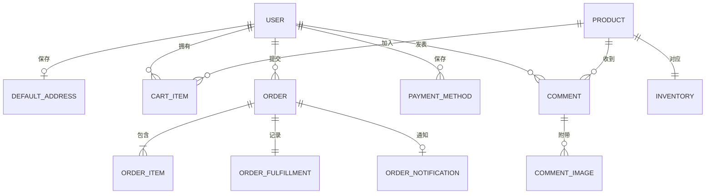

# 分子项链商城：后端功能拆解与 AI 提示词写法

> **用途**：20 页主体讲稿，加 4 页真实支付接入附加讲稿，面向非技术听众。每页保留必须认识的术语，用生活例子解释，再展示本项目的做法与可复用提示词。项目现状依据 2026-10-08 工作区代码整理；支付附加页依据文末所列官方资料整理，接入条件以申请时的平台审核结果为准。
>
> **复刻方式**：学生没有本项目源码时，先复制下方「通用开场提示词」，再按顺序复制各页的「精准提示词」。提示词要求 AI 在学生自己的电脑上搭建服务；数据库账号、密码、目录和飞书配置由学生自行设置。

## 通用开场提示词（先发给 AI）

> 请从零制作一个“分子项链商城”后端。使用 Python、FastAPI 和 PostgreSQL；所有接口以 `/api` 开头，返回 JSON。先给出可在我本机运行的目录结构、依赖、`.env.example`、启动步骤，再逐模块实现。数据库连接和密钥从环境变量读取，不写死电脑路径或密码。每次只完成我当前指定的模块，说明依赖的前置模块；不要擅自添加真实支付或改动已完成模块的接口。每完成一块，给出请求示例、预期响应、失败响应、自动测试和运行结果。商品初始数据是 17 款分子项链，每款默认库存 12。当前只记录支付方式，不进行真实扣款。请使用清晰的中文错误信息；对无法在本机完成的商户申请或公网配置，只列出所需条件，不伪称已开通。

---

## Slide 01｜一笔订单背后，后端做了什么

- **一句话**：后端是商店的“收银台 + 仓库账本 + 店长工作台”。
- **用户旅程**：看商品 → 注册登录 → 加购物车 → 选配送和支付方式 → 下单 → 扣库存 → 飞书通知店主。
- **术语**：*前端*是顾客看到的页面；*后端*负责验证规则、保存数据和连接外部服务。
- **术语展开**：前端负责把商品、按钮和结果呈现给人；后端接到请求后判断“这个人能否买、价格是多少、库存是否够”，再把结果返回。浏览器关闭后仍要保留的数据交给数据库。
- **本项目**：页面在 `frontend/app/`，商城服务在 `backend/shop_api/`；前端通过接口取得商品和订单数据。
- **精准提示词**：
  > 请先不要写代码。以“游客浏览商品→注册登录→加入购物车→填写配送信息→创建模拟订单→库存减少→飞书通知店主”为主线，画出前端、后端和数据库之间的流程图；再用“顾客操作/后端判断/数据变化/失败提示”四列表逐步解释。指出哪些步骤必须登录、哪些只是模拟支付，并列出后续开发模块的依赖顺序。

---

## Slide 02｜如何把想法说成有效的提示词

- **核心原则**：写清“谁来用、要做什么、输入什么、成功后看到什么、失败时怎么办”。
- **比喻**：只说“做购物车”，像对店员说“帮我买东西”——没有商品、数量和规则。
- **推荐结构**：场景 → 功能 → 规则 → 边界情况 → 验收方法。
- **术语展开**：*边界情况*指规则最容易出错的地方，例如数量为零、两人同时抢最后一件；*验收*指事先规定什么结果算正确，而不是“页面看起来能用”。
- **示例**：“登录用户能把商品加入购物车；重复添加则累加数量；数量小于 1 时拒绝；其他用户看不到这条记录；给出测试。”
- **精准提示词**：
  > 请先把“做一个购物车”改写成开发任务书，再按任务书实现：说明谁能使用、添加时提交商品编号和正整数数量、重复添加如何处理、读/改/删返回什么、他人条目如何拒绝、商品下架或不存在如何提示。列出至少 5 个可执行验收场景，每个场景写“初始数据、操作、预期数据变化”；实现后逐项运行并报告结果。

---

## Slide 03｜接口与路由：页面怎样找到后端

- **术语**：*API 接口*是前后端约定的服务入口；*路由*是“请求地址该交给哪个处理函数”的分配表。
- **术语展开**：一次接口调用包含“方法、地址、输入、响应”，例如 `GET /api/products` 是读取商品，`POST /api/cart` 是新增购物车内容；路由负责把这两种请求送到不同代码。
- **比喻**：像商场导览牌，`/api/products` 去商品柜台，`/api/cart` 去购物车柜台。
- **本项目实现**：商品、账户、评论、购物车、订单接口集中在 `routers.py`；管理员接口在 `admin_router.py`；`main.py` 负责把它们装进应用。输入由 `schemas.py` 检查。
- **边界**：前端页面地址 `/cart` 与后端接口 `/api/cart` 是两件事。
- **精准提示词**：
  > 请为商城列一张接口契约表，包含注册、登录、当前用户、商品列表/详情、购物车查询/添加/改数量/删除、创建订单/查询订单、管理员接口。每行写请求方法、`/api` 地址、登录要求、输入字段、成功响应示例、常见错误状态。随后用 FastAPI 实现路由和输入检查；业务错误统一返回 `{"message":"原因"}`。用请求示例验证 `GET /api/products` 与 `POST /api/cart` 不会混淆。

---

## Slide 04｜为什么选 PostgreSQL

- **术语**：*数据库*是可查询、可长期保存的电子账本；*持久化*指服务重启后数据仍在。
- **术语展开**：*关系型数据库*把数据分成互有关联的表；PostgreSQL 是这类数据库的一种。SQLite 把小型数据库放在文件里，适合本机测试；两者都能保存数据，但部署和多人并发能力不同。
- **选型理由**：用户、购物车、订单、库存相互关联；下单时多处数据必须一起更新。PostgreSQL 适合这种关系明确、需要可靠交易记录的场景。
- **对比**：内存里的列表重启会丢；CSV 难以安全处理多人同时下单；SQLite 适合轻量测试，本项目主要运行库选 PostgreSQL。
- **本项目实现**：默认连接本机 `nzw` 数据库，业务表放在 `shop` schema；连接地址可配置，测试使用独立 SQLite。
- **精准提示词**：
  > 请为有用户、购物车、订单和库存的商城选择数据库。先用“重启后是否保留、能否表达表间关系、多人同时下单、维护成本”四项比较内存列表、CSV、SQLite、PostgreSQL；再确定 PostgreSQL 为运行库、独立 SQLite 为测试库。给出创建数据库、配置 `DATABASE_URL`、连接失败排查和“重启后订单仍存在”的验收步骤，不写死我的本机密码。

---

## Slide 05｜数据库表：为什么不放在一张大表

- **术语**：*表*像一类专用登记簿；*一对多*表示一个用户可以有多笔订单。
- **术语展开**：*行*是一条记录，*列*是记录的属性。例如 `products` 的一行是一款项链，`name` 和 `price` 是它的列。分表让“商品当前资料”与“某次购买事实”各自保存，避免互相覆盖。
- **设计思路**：用户表管身份；商品表管介绍和价格；库存表管剩余数量；购物车表管“打算买”；订单表管“已经提交”。
- **本项目主要表**：`users`、`products`、`inventory`、`cart_items`、`orders`、`order_items`、`order_fulfillments`。
- **为什么分表**：如果把每次购买都写在商品表里，商品介绍会被重复很多次，也难以回答“某人买过什么”。
- **精准提示词**：
  > 请设计并建立 `users`、`products`、`inventory`、`cart_items`、`orders`、`order_items`、`order_fulfillments` 七张核心表。逐表列出必需字段、字段含义、主键和关联；说明“一个用户的一个订单含两种商品”会写入几行。商品价格用精确小数保存；订单明细保存下单时名称、单价、数量，配送表保存本次地址。给出建表后的样例查询，并解释为何不把所有数据塞进一张表。

---

## Slide 06｜ER 图：把数据之间的关系画出来

- **术语**：*ER 图*是“实体—关系图”；方框是数据对象，连线表示它们之间的联系。
- **术语展开**：*实体*可理解为要长期记录的东西，例如用户、商品和订单；*关系*回答“谁拥有、谁包含谁”。图上的 `||` 可读作“恰好一个”，`o{` 可读作“零个或多个”。
- **读图方法**：一个用户可以有多条购物车记录和多个订单；一个订单可以有多条商品明细。
- **本项目核心关系**：

- **说明**：`ORDER_ITEM` 保存商品名称和价格快照，因此核心模型没有强制依赖当前商品记录；评论图片允许先上传、后绑定评论。
- **精准提示词**：
  > 请画 Mermaid ER 图，包含用户、默认地址、商品、库存、购物车条目、订单、订单商品、订单配送、评论和评论图片。按“用户可有多个订单、订单至少一条商品明细、商品恰有一条库存、用户最多一个默认地址”标出数量关系。画完后用“用户 A 买苯项链 2 件和血清素项链 1 件”逐条说明会创建哪些记录；再检查图和数据表中的外键是否一致。

---

## Slide 07｜主键、外键、唯一约束与订单快照

- **术语**：*主键*像每条记录的唯一编号；*外键*像写在记录上的“关联编号”；*约束*是数据库自己执行的规则。
- **术语展开**：主键让两笔同名商品也有不同身份；外键保证购物车中的商品编号确实指向一款商品；唯一约束防止重复账号，检查约束可以挡住负库存。*快照*是把下单当时的重要信息抄到订单里。
- **本项目例子**：账号不能重复；同一用户的同一商品在购物车只能有一行；库存不能小于零。
- **订单快照**：今天买时是 ¥10、地址是 A；明天商品涨价、用户改为地址 B，旧订单仍显示 ¥10 和 A。像拍下当时的小票。
- **扩展表**：默认地址、银行卡、评论图片、订单通知和操作日志各有自己的记录，不混进订单主表。
- **精准提示词**：
  > 请为商城表添加主键、外键和约束：`users.username` 唯一；`cart_items` 的“用户+商品”组合唯一；`inventory.quantity >= 0`；每个订单最多一份配送快照。下单时把商品名称、单价、购买数量和本次地址写进订单相关表。给出两项自动测试：下单后把商品从 ¥10 改为 ¥15，旧单仍是 ¥10；下单后改默认地址，旧单地址不变。

---

## Slide 08｜事务：防止下单做到一半

- **术语**：*事务*指几件数据操作“要么一起成功，要么一起取消”；*回滚*是失败后恢复原状。
- **术语展开**：*提交*是把一组操作正式写进数据库；*行锁*是在多人同时修改同一件商品库存时，让相关操作排队，避免两个人都读到“还剩 1 件”后各买一件。
- **比喻**：店员不能只收钱不出单，也不能只扣库存不记购买者。
- **本项目实现**：提交订单时检查库存，扣库存，写订单、商品明细、配送快照和通知记录，移除已买购物车条目，然后统一提交；库存不足则回滚。
- **多人同时买**：读取并锁定相关库存记录，避免同一件商品被同时卖给两个人。
- **精准提示词**：
  > 请把下单的库存检查、金额计算、订单与商品快照创建、库存扣减、已买购物车条目删除放在同一数据库事务中。任一步失败都回滚，并返回明确原因。针对 PostgreSQL 的并发下单锁定相关商品和库存记录；写测试证明“库存 12、买 13 件”没有订单也不扣库存，以及“两人同时买最后 1 件”只有一人成功。

---

## Slide 09｜注册：先检查，再保存

- **术语**：*校验*是数据进入系统前的检查；*密码哈希*像只能验证、不能还原的密码指纹。
- **术语展开**：校验既要在页面做以便及时提示，也要在后端做以防绕过页面。哈希不是把密码“藏起来待会解密”，而是登录时重新计算、比较两份指纹。
- **本项目规则**：账号至少 3 位，只能用字母、数字和下划线，不能重复；密码至少 9 位，包含大小写字母、数字、特殊字符，且两次输入一致。
- **实现方法**：后端检查输入 → 查重 → 保存密码哈希 → 告知注册结果。不能只依赖页面检查，因为有人可绕过页面直接调用接口。
- **精准提示词**：
  > 请实现 `POST /api/auth/register`，输入为 `username`、`password`、`confirmPassword`。先去掉账号首尾空格，再要求账号至少 3 位且只含字母、数字、下划线；密码至少 9 位并含大小写字母、数字、特殊字符；两次一致；账号重复返回 409。成功返回 201 和中文成功消息，数据库只存密码哈希。写成功、弱密码、密码不一致、重复账号及“数据库无明文密码”的测试。

---

## Slide 10｜登录、鉴权与角色权限

- **术语**：*认证*是确认“你是谁”；*鉴权*是确认“你能做什么”；*JWT*是登录后携带的限时凭证。
- **术语展开**：用户登录时取得 JWT，此后把它放进请求头，后端检查签名和有效期。*角色权限*区分普通顾客与管理员；*数据权限*进一步保证即使两个顾客角色相同，也不能互看订单。
- **比喻**：登录像在门口核对身份；普通顾客与店长拿到的钥匙能开不同的门。
- **本项目实现**：登录核对密码哈希，签发 12 小时凭证；每次需要登录的请求都验凭证和用户状态；管理员接口还检查 `admin` 角色。停用用户即使持有旧凭证也不能继续操作。
- **边界**：顾客只能查看自己的订单、地址、银行卡和购物车。
- **精准提示词**：
  > 请实现 `POST /api/auth/login` 和 `GET /api/auth/me`。登录核对密码哈希，成功返回含用户编号的 12 小时 JWT 及用户编号、账号、角色；错误账号或密码返回 401。需要登录的接口读取 Bearer Token，并再次读取数据库中的用户状态；停用用户返回 403，管理员接口还须检查 `role=admin`。查询订单、购物车、地址和银行卡时按当前用户编号筛选，越权访问按 404 处理。测试缺失/过期/伪造 Token、普通用户进管理页、用户 A 读取用户 B 订单、停用用户持旧 Token。

---

## Slide 11｜商品上架、下架与价格管理

- **核心原理**：商品介绍、价格、图片和“是否在售”属于商品信息；剩余件数属于库存信息。
- **术语展开**：*上架*表示商品可以被顾客浏览和购买；*下架*表示暂时停售，不等于删除旧订单。*低库存阈值*是提醒补货的数字，本项目是剩余 5 件及以下。
- **本项目实现**：顾客只看到上架商品；管理员可上传商品图、发布新品、补货、下架、重新上架和调价。低库存提示阈值为 5 件。
- **关键规则**：下架商品不能再加入购物车或提交订单；修改当前价格不应修改旧订单的价格快照。
- **精准提示词**：
  > 请实现公开的 `GET /api/products`、`GET /api/products/{id}`，返回商品编号、名称、价格、简介、故事、图片、当前库存；只展示上架商品。管理员可创建新品、上传图片、补货、下架、重新上架及设置新价格或上/下调 10%、20%、30%，这些写操作必须检查管理员身份并记录日志。库存为 0 标售罄，1～5 件标低库存；下架商品不能加入购物车或下单；旧订单保存原购买价。测试上架/下架、调价、补货和旧订单不变。

---

## Slide 12｜购物车：购买意向，不是订单

- **术语**：*购物车条目*记录“某人打算买某商品多少件”，还没有实际扣库存。
- **术语展开**：购物车像顾客拿着的篮子，“放进篮子”不代表完成购买，也不保证该件商品一直留给他。*用户隔离*指数据库里的每个篮子都有主人，不能凭猜到条目编号就修改别人的篮子。
- **本项目实现**：用户可添加、查看、修改数量和删除；重复添加同一商品时合并数量；结算时可只勾选其中几项。
- **边界**：购物车可以暂时超过库存，真正能否购买在下单时重新检查；不能操作别人的条目。
- **精准提示词**：
  > 请实现 `GET /api/cart`、`POST /api/cart`、`PATCH /api/cart/{item_id}`、`DELETE /api/cart/{item_id}`，都要求登录。添加输入商品编号和正整数数量；同一用户重复添加同一商品时数量累加。返回每条的编号、商品、数量和实时库存；改/删他人条目返回 404。购物车暂不扣库存，用户可从中选部分条目下单。测试重复添加、数量为 0、商品不存在、两用户隔离和只删除选中条目。

---

## Slide 13｜默认地址与模拟支付方式

- **核心原理**：默认地址是用户经常使用的地址；订单地址是某次购买的历史记录，两者不能混为一谈。
- **术语展开**：默认地址像通讯录里的常用地址；订单快照像寄件面单，即使之后改通讯录，也不能回头修改已经寄出的面单。*模拟支付*只是记录用户想用哪种方式付款，并不会转移资金。
- **本项目实现**：保存一个默认地址；结算时可带入。配送可选线下自提、顺丰次日达或其他快递。支付可选微信、支付宝或已保存银行卡。
- **银行卡处理**：输入时检查卡号，保存时加密，页面和订单只显示末四位。
- **明确边界**：记录支付选择，不接入微信、支付宝或银行的真实扣款接口。
- **延伸**：若课程要讲“真正拉起支付”，接着使用附加 Slide 21～24；它们是未来接入方案，不是当前代码已有的功能。
- **精准提示词**：
  > 请实现登录用户的 `GET/PUT /api/account/address` 和 `GET/POST /api/payment-methods`。每人最多一个默认地址，包含收件人、11 位大陆手机号、省、市、区、详细地址；订单另存本次使用的地址。银行卡允许空格或连字符，规范化后检查 12～19 位数字与 Luhn 校验；加密保存，只返回末四位和标识，不能返回完整卡号。结算时可记录微信、支付宝或本人保存的银行卡，不能使用他人卡，不能发生真实扣款。测试地址更新不影响旧订单、无效卡、重复卡和响应不泄露完整卡号。

---

## Slide 14｜下单：把购物意向变成正式记录

- **步骤**：选择购物车条目 → 检查商品仍在售且库存足够 → 算商品金额和运费 → 保存订单及快照 → 扣库存。
- **术语展开**：*订单*是一次购买的正式记录；*订单明细*列出具体买了哪几件；*配送快照*记录本次选择的快递、自提点与收件地址。
- **本项目运费**：顺丰次日达 ¥5；线下自提、圆通、国通、申通、韵达免费。自提点是常州市天宁区文化广场小行星桌游社。
- **输出**：订单号、总价、商品明细、配送与支付选择、通知状态；顾客只能读取自己的订单。
- **精准提示词**：
  > 请实现 `POST /api/orders` 和 `GET /api/orders/{id}`。提交选中的购物车条目编号、配送方式、支付方式及本次地址；只结算当前用户确实拥有的条目，空选择拒绝。配送支持线下自提、顺丰次日达、圆通、国通、申通、韵达；仅顺丰加 ¥5，自提点固定为常州市天宁区文化广场小行星桌游社。金额由后端从当前商品价计算，拒绝下架或库存不足商品；成功时保存订单、商品单价/数量快照及配送快照，扣库存并移除已买条目。返回订单号、总价、明细、配送和通知状态；只有本人可查。测试部分结算、运费、库存不足回滚和越权查询。

---

## Slide 15｜库存管理：为什么不能只靠页面显示

- **核心原理**：商品页显示“还剩 1 件”只是某一刻的照片；提交订单时必须再次读取库存。
- **术语展开**：*并发*是多名顾客几乎同时操作；*超卖*是实际只有 1 件却生成 2 笔成功订单。页面上的库存数字是供顾客参考，真正的决定发生在后端提交订单时。
- **本项目实现**：库存单独保存；下单时核对并扣减；管理员可补货。数据库约束防止出现负数。
- **生活例子**：两位顾客都看到最后一件，最终只能有一位成功下单。
- **精准提示词**：
  > 请让 `inventory` 为每款商品保存非负整数库存。商品列表、详情和购物车显示实时库存；管理员补货只能加正整数。加入购物车不扣库存，下单时在同一事务内锁定库存、重新检查并扣减。写并发测试：先把库存调成 1，两名用户同时提交订单，预期一人成功、一人收到库存不足，最终库存为 0 且只新增一笔成功订单。

---

## Slide 16｜商品评论、图片与内容安全

- **术语**：*富文本*是带加粗、颜色、图片的评论；*XSS*是把危险网页代码混进评论的攻击。
- **术语展开**：普通文字评论不能表达排版；富文本把允许的 HTML 标签存起来。XSS 会让评论中的脚本在其他顾客页面运行，因此后端应像门卫一样只放行允许的标签、属性和图片来源。
- **本项目实现**：公开读取评论；登录后可发布；图片单张不超过 5 MB，只接受 JPG、PNG、WebP、GIF；发布时确认图片归当前用户所有，并清理危险 HTML。
- **关键点**：评论保存发布时的作者名；只允许已上传且尚未被其他评论使用的图片。
- **精准提示词**：
  > 请实现公开的 `GET /api/products/{id}/comments`、登录后上传图片的 `POST /api/comment-images` 和发评论的 `POST /api/products/{id}/comments`。评论可有段落、加粗、斜体、下划线、文字颜色和图片，但保存前清理脚本及危险属性。图片仅接受 JPG/PNG/WebP/GIF，单张不超过 5 MB；保存随机文件名。发布时检查每张图属于当前用户、未绑定其他评论，并与评论中的图片链接一致；最新评论排前。测试非法格式、超大图片、他人图片、重复引用和 XSS。

---

## Slide 17｜飞书协同：下单成功后通知店主

- **术语**：*异步任务*是在订单已建立后继续做的事；*重试*是外部服务暂时失败后再发送。
- **术语展开**：飞书是商城之外的服务，像把订单短信交给邮局；不能让“邮局暂时没送到”导致订单消失。*通知状态*让店主知道消息仍待发送、已送达或重试用尽。
- **本项目实现**：创建订单后发送飞书交互卡片，包含订单号、商品、账号、手机号、配送方式及地址。失败不取消订单；通知记录保持待发送，启动时和之后每 5 分钟重试，最多 6 次。
- **边界**：只有配置了飞书应用与会话才发送；不接收飞书回调。
- **精准提示词**：
  > 请在订单提交成功后创建一条 `pending` 通知记录，再异步发送飞书交互卡片到环境变量指定的会话。卡片列出订单号、各商品及数量、下单账号、完整联系电话、配送方式和配送地址或自提点。发送失败只更新失败原因和尝试次数，不撤销订单；服务启动及每隔 5 分钟重试待发送记录，最多 6 次，成功改为 `notified`，用尽次数改为 `failed`。未配置飞书时订单照常创建。用替身网络响应测试成功、失败、重试，测试绝不向真实群发单。

---

## Slide 18｜管理员看板与操作日志

- **术语**：*看板*把多张表汇总成经营信息；*审计日志*记录“谁在什么时候改了什么”。
- **术语展开**：*汇总*把许多订单折算为“今日几单、销售额多少”；*筛选*让店长只看某日期或某商品；审计日志像值班记录，出现误下架时能追查操作者和修改前后的值。
- **本项目实现**：管理员查看今日订单和销售额、用户数、在售商品数、缺货与低库存、时间趋势、热销商品和订单明细；日期按中国时间统计。管理员可停用/恢复用户、管理商品。
- **注意**：看板里的“当前库存”是现在还剩多少，不是订单发生时的库存快照。
- **精准提示词**：
  > 请实现 `/api/admin` 下的管理员接口。看板按中国标准时间统计今日订单数/销售额、累计销售额、有效用户数、在售商品数、缺货和低库存数；允许按日期范围查看趋势、热销商品、购买用户排行和可分页的订单明细。用户管理支持停用/恢复，商品管理支持补货、上下架、调价；每次写操作记录操作者、目标、动作、修改前后值和时间。仅 `admin` 角色可访问，普通用户返回 403。测试跨日统计、筛选、分页、权限和审计记录。

---

## Slide 19｜测试：如何知道后端真的可用

- **术语**：*单元测试*检查一个小规则；*接口测试*像真实用户一样发请求；*集成测试*检查多个模块一起工作。
- **术语展开**：单元测试可只测“密码是否够强”；接口测试向服务发送请求并检查响应；集成测试跨多个模块，例如从加购物车一直走到订单与库存。*测试隔离*指实验数据不能写进真实经营数据。
- **本项目现状**：现有 `pytest` 用独立的测试数据库和临时上传目录，覆盖注册、购物车下单、库存回滚、评论图片、地址和卡号、管理员权限与看板等。主要是接口/集成测试，不能笼统称为完整单元测试体系。
- **验收例子**：库存 12，买 13 应失败，库存仍是 12；管理员停用用户后，原有登录凭证也不能继续使用。
- **精准提示词**：
  > 请用 pytest 为商城写可重复运行的测试，创建独立临时数据库和上传目录，并用模拟对象替换飞书网络请求。至少检查：弱密码/重复账号被拒、未登录不能改购物车、A 不能读 B 的订单、正常下单扣库存且只删除已购条目、库存不足完整回滚、旧订单价格和地址不变、评论清理脚本和他人图片、飞书失败仍留订单、管理员停用用户后旧 Token 失效。运行测试并给出“通过数、失败数、仍未覆盖的风险”；不要把现有接口测试称为全部单元测试。

---

## Slide 20｜课堂复刻路线与真实边界

- **推荐顺序**：启动服务 → 数据库与 ER 图 → 注册登录 → 商品 → 购物车 → 地址 → 下单与库存 → 评论 → 飞书 → 管理员 → 测试。
- **每轮提示词都写**：功能目标、数据输入、成功输出、失败情况、权限、测试和本机运行说明。
- **术语展开**：*迭代*指每次只加一块可运行的功能；*验收标准*指学生和 AI 都能客观检查的结果，例如“库存不足返回 409，数据库中的库存不变”。
- **当前项目的边界**：支付是模拟选择，没有扣款；订单创建不等于已付款或已发货；飞书通知失败不影响订单；管理员账户需由已有数据或人工配置，普通注册不会成为管理员。
- **课堂练习**：让学生先写“用户能买到最后一件商品”的提示词，再补充“两人同时买、库存不足、下架、飞书失败”四个边界场景。
- **选讲**：Slide 21～24 说明真实支付接入所需条件、渠道流程和建议提示词。
- **精准提示词**：
  > 请按“服务启动→数据库→账号→商品→购物车→地址→模拟订单与库存→评论→飞书→管理员→测试”的顺序，给我一份逐轮开发计划。每轮必须写要实现的功能、依赖、输入输出、失败场景、客观验收标准和我在自己电脑上的运行命令；一轮完成并验收后再进入下一轮。最后列出尚未具备的真实支付、退款和生产部署能力，不得把选择支付方式写成已经收款。

---

## Slide 21｜真实支付不是加一个按钮：接入前要准备什么

- **当前与目标**：现有商城只保存“微信/支付宝/银行卡”的选择，订单创建后直接扣库存；尚无支付发起、支付回调、已付款状态、退款或对账。下面是**拟接入步骤**，不代表已经实现。
- **先决定场景**：用户在电脑网页、手机浏览器、微信内网页还是 App 付款？不同场景可能需要不同的产品权限与唤起方式。
- **开通条件**：有可完成商户入驻和签约的经营主体、结算账户、真实商品与网站；向相应平台申请商户身份及具体支付产品权限。资格、经营类目和材料由平台审核，不能靠代码绕过。
- **技术条件**：准备网站域名、HTTPS、可从公网访问的支付通知地址，以及商户号/应用 ID、签名密钥或证书；把密钥留在服务端，不能写进网页或 PPT。
- **生活比喻**：先向收银机构开户、领收银机和钥匙，再谈怎样把收银机接到店里。
- **术语展开**：*商户号*是平台给店铺的身份编号；*应用 ID*标识具体网站/小程序；*证书或密钥*证明请求确由这家店发出；*公网回调*是平台能访问的后端通知入口，本机 `localhost` 不能直接充当正式回调地址。
- **精准提示词**：
  > 我有一个 FastAPI 商城，现有订单只有模拟支付。只写准备清单，不写支付代码。按“电脑网页、微信外手机浏览器、微信内网页”分别列出微信支付、支付宝和银联托管支付所需的商户主体及结算账户、产品签约与审核、应用/商户编号、授权域名、HTTPS、公网通知地址、证书或密钥、测试账号和生产开通步骤。输出一张“条件/由谁申请/在哪里配置/如何验证/未具备时能否继续模拟”的表；用官方文档核对每项，不推断我已经拥有资质。
- **官方依据**：[微信支付开发参数](https://pay.wechatpay.cn/doc/v3/merchant/4013070756)、[支付宝网页应用接入流程](https://open.alipay.com/module/webApp)、[银联商户入网](https://open.unionpay.com/tjweb/join/index?type=0)。

---

## Slide 22｜微信与支付宝：用户点击后怎样拉起收银台

| 场景 | 具体步骤 | 用户看到什么 |
|---|---|---|
| 电脑网页微信支付 | 开通对应权限；后端用本地订单号和**后端计算的金额**向微信发起 Native 下单；收到 `code_url` 后展示二维码 | 用微信扫码、核对金额并付款 |
| 手机浏览器微信支付 | 确认是微信外的手机浏览器且已开通 H5 权限、配置域名；后端下单得到 `h5_url`；页面跳转 | 唤起微信支付页面 |
| 微信内网页 | 选择并开通适用的 JSAPI 产品，准备已绑定的应用身份、授权域名和用户标识 | 在微信内调起收银台 |
| 电脑网站支付宝支付 | 创建并审核应用、开通网站支付产品、配置密钥；后端按订单生成支付请求，浏览器前往支付宝收银台 | 登录支付宝或扫码完成付款 |
| 手机网站支付宝支付 | 申请适用于手机网页的支付产品；后端生成该场景的支付请求，手机网页跳转 | 在手机上的支付宝支付页面确认付款 |

- **术语**：*预支付单*是支付平台为这次订单准备的收款入口；得到二维码或跳转链接，只表示“可以付款”，还不表示“付款成功”。
- **术语展开**：`code_url` 是微信扫码二维码的内容；`h5_url` 是微信外手机浏览器跳转入口；微信内 JSAPI 要在获得用户标识后拉起收银台。*支付场景*决定该用哪个入口，不能仅根据按钮上的“微信支付”四字选择接口。
- **结果入口**：浏览器返回页只用于向顾客展示进度；后台通知或后端主动查单才用于确认钱是否付到。支付宝的应用开通和具体产品权限也要分别核实。
- **注意**：支付宝手机网站也应选择与手机网页匹配的已签约产品，不能把电脑网站、手机网站和 App 支付接口混用。
- **精准提示词**：
  > 请只写网页商城的支付唤起方案，不写代码。分别给出电脑网页微信 Native 扫码、微信外手机浏览器 H5、微信内网页 JSAPI、支付宝电脑网站和手机网站的适用条件、需要开通的产品、后端下单请求所需订单号/金额/通知地址、返回给前端的信息及用户看到的页面。金额必须由后端从待付款订单读取，不能采用浏览器提交的价格。每个场景用 5～8 步流程写清从点击按钮到进入收银台；区分“已生成支付入口”和“已付款”，并列出至少一个不适用场景。
- **官方依据**：[微信 Native 下单](https://pay.wechatpay.cn/doc/v3/merchant/4012791877)、[微信 H5 指引](https://pay.wechatpay.cn/doc/v3/merchant/4012791831)、[微信 JSAPI 指引](https://pay.wechatpay.cn/doc/v3/merchant/4012791870)、[支付宝网页接入](https://aipay.alipay.com/docs/vibe-pay/ai-web-app-payment-qianyi/ai-web-app-payment-integration-guide.html)。

---

## Slide 23｜银行卡：让收单机构处理卡号

- **推荐路径**：申请银联在线网关支付，或选择有资质的收单机构/支付服务商提供的托管收银台。商户后端发起交易，浏览器跳到对方页面；顾客在该页面输入卡号和验证码，再回到商户网站。
- **为什么**：当前项目虽然能保存加密卡号，但这**不能直接变成真实银行卡扣款能力**。接入真实支付时，不应让自建商城页面接收完整卡号、有效期、CVV 或短信验证码；已有卡号保存设计需单独审查和迁移。
- **接入步骤**：确认商户和产品准入 → 签约与测试 → 取得商户编号/签名材料 → 发送订单号与金额 → 跳转托管收银台 → 验证后台通知 → 查询与对账。
- **术语**：*收单机构*是负责受理商户银行卡交易的机构；*PCI DSS*是支付卡数据安全标准。即使支付页面外包，商户仍需与服务商确认各自的安全责任。
- **术语展开**：*托管收银台*由支付机构提供付款页面，顾客在那里输入卡片资料；商城只拿到支付结果和必要的交易编号。*卡令牌*是由支付机构提供、可代表已授权卡片的代号，不能把自建数据库里的卡号密文当作卡令牌。
- **精准提示词**：
  > 请只规划银行卡支付，不写代码。优先比较银联在线网关与合规收单服务商托管收银台：列出签约条件、用户跳转、支付机构采集卡片信息、平台后台通知、商户验签、主动查单、退款和对账步骤。明确我的商城不得在自建页面收集或记录完整卡号、CVV、有效期、短信验证码；现有“加密保存完整卡号”只是模拟选择遗留功能，给出停用入口、排查数据、受控删除或迁移到支付机构令牌的方案。说明即使外包收银台，商户仍要与收单机构确认 PCI DSS 责任范围。
- **官方依据**：[银联在线网关支付](https://open.unionpay.com/tjweb/acproduct/list?apiSvcId=448&index=4)、[PCI SSC 对外包支付的说明](https://www.pcisecuritystandards.org/faqs/does-pci-dss-apply-to-merchants-who-outsource-all-payment-processing-operations-and-never-store-process-or-transmit-cardholder-data/)。

---

## Slide 24｜付款结果：以后台确认，不以页面跳转为准

- **生活比喻**：顾客说“我已付款”不能直接当收据；店主还要看收银机构的到账记录。
- **接入时要改的订单流程**：订单先成为“待支付”；记录支付渠道、商户订单号、平台交易号、金额与时间。库存先保留多久、超时怎样释放，需要明确规则；不能沿用“创建订单就等于完成交易”的理解。
- **后台确认步骤**：支付平台发来通知 → 核对签名/解密 → 对照本地订单号、商户身份、金额和支付状态 → 仅第一次成功时改为“已支付” → 重复通知不重复扣库存或发货。通知丢失时主动查单；定期对账，另行处理取消、超时和退款。
- **术语**：*回调*是支付平台主动通知商城；*验签*确认消息来源；*幂等*指重复通知处理多次，结果仍和处理一次相同。
- **术语展开**：*主动查单*是商城向支付平台再次询问真实状态；*对账*是每天把商城订单与平台账单逐笔核对。*竞态*指超时关单与付款通知几乎同时到达，系统必须有确定的处理规则。
- **与飞书的关系**：需要约定是“下单即通知”还是“付款成功后通知”，卡片文案必须准确区分待付款与已付款。
- **精准提示词**：
  > 请只设计、不实现商城从模拟支付升级为真实支付的订单状态机和数据库变更。列出待付款、已支付、已关闭、已退款状态及允许的转换；每笔支付尝试有唯一商户交易号，记录渠道、订单金额、平台交易号和时间。支付成功必须由后端验签并核对商户身份、订单号、金额及状态，或由平台查单确认；浏览器返回页只触发查询。说明回调重复/丢失、支付超时释放库存、超时与成功同时发生、退款、每日对账分别如何处理；每个情况给一条验收场景。明确现有“创建订单即扣库存”和飞书下单通知需要怎样调整，并说明绝不能重复扣库存或重复发货。
- **官方依据**：[微信支付结果确认](https://pay.wechatpay.cn/doc/v3/merchant/4012791831)、[支付宝异步通知与查单](https://aipay.alipay.com/docs/vibe-pay/ai-web-app-payment-qianyi/ai-web-app-payment-integration-guide.html)、[银联交易查询与对账](https://open.unionpay.com/tjweb/support/doc/online/7/245)。

### 四页合用的建议提示词

> 我已有一个 Python FastAPI 商城，当前可注册、加购物车和下单，但微信、支付宝和银行卡都只是模拟选项。请**只输出教学用接入方案，不修改代码、不发起真实交易**。目标是在电脑网页和手机网页提供真实付款。先分别说明电脑网页、微信外手机浏览器、微信内网页适用的官方支付产品，核对最新官方资料；再列出商户入驻、产品开通、域名/HTTPS、公网回调、证书/密钥、沙箱或测试环境等先决条件，标明“需商户申请”还是“开发者配置”。分微信、支付宝、银行卡托管收银台写出“点击付款→待付款订单→后端按数据库金额向平台申请支付入口→浏览器扫码/跳转→平台异步通知→验签与金额核对→状态更新→查单与对账”全过程。设计重复通知、通知丢失、超时关单与库存释放、退款、支付与关单竞态、飞书通知时点。银行卡不得在自建页面收集或保存卡号、CVV、有效期、验证码，并评估现有模拟卡号数据的迁移。输出一张流程图、一张“准备条件/负责人/验收结果”表、一张“异常场景/系统处理/验收结果”表；区分现有功能与计划功能，并链接每个渠道的当前官方文档。

---

## 备课核对：本讲稿对应的项目文件

| 讲述内容 | 主要代码位置 |
|---|---|
| 应用入口、路由装配、跨域、定时重试 | `backend/app.py`、`backend/shop_api/main.py` |
| 顾客接口、注册登录、购物车、下单、评论 | `backend/shop_api/routers.py` |
| 管理员接口、经营看板、操作日志 | `backend/shop_api/admin_router.py` |
| 数据表及关系、订单快照 | `backend/shop_api/models.py` |
| 数据库连接和旧库增量更新 | `backend/shop_api/database.py` |
| 登录凭证、角色权限、银行卡校验 | `backend/shop_api/security.py` |
| 商品初始数据、图片保存、购物车展示 | `backend/shop_api/services.py` |
| 飞书卡片和重试 | `backend/shop_api/notifications.py` |
| 接口与集成测试 | `backend/tests/test_api.py` |
| 前端实际调用位置 | `frontend/app/shop.tsx`、`frontend/app/cart/page.tsx`、`frontend/app/admin/page.tsx` |

> **讲师备注**：原始需求文件曾写 Flask，但当前运行代码是 FastAPI；讲课请以当前代码为准。当前数据库默认是 PostgreSQL 的 `nzw` 数据库、`shop` schema；学生复刻时应允许自行配置名称和连接信息。
