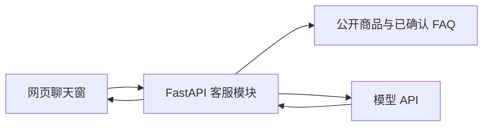

# 网页 AI 小客服可行性研究

Mika，2026-11-01，TTXL-8。源码基线：本地 `dev`，`2545dad`。本次独立研究，未启动其他智能体，未调用付费模型或读取真实配置、密钥、顾客数据，未修改业务代码或部署。下文区分已有能力与建议方案；未做模型实测、页面原型或上线验收。

## 判断与首版范围

可以做。建议定位为“分子项链导购小助手”：在商城右下角提供文字聊天入口，回答商品问题、按预算和设计偏好推荐作品，并提供可点击的商品卡片。复用现有 React 前端和 FastAPI 后端，增加客服模块即可，无须先拆微服务、训练专属模型或自建推理服务器。这是针对当前代码结构的工程判断，不代表模型质量与线上容量已验证。

访客可咨询公开商品；私人订单查询放到第二阶段，复用登录身份。第一版不提供自动下单、退款、改地址或优惠审批，也不把“联系店主”包装成已有人实时接线。公开联系方式和人工处理方式需要店主确认后再展示。

## 仓库已具备的条件

| 能力 | 源码证据 | 接入意义与限制 |
| --- | --- | --- |
| React 客户端和全站布局 | `frontend/app/layout.tsx`、`frontend/app/components/` | 可挂载独立客户端聊天组件；服务端与浏览器初次渲染保持一致，避免 hydration 问题。管理员页面可隐藏入口。 |
| 商品资料、价格和库存 | `backend/shop_api/models.py:41–49`、`routers.py:109–119` | 已有上架商品列表与详情接口。客服应从后端获取当前值，不从模型记忆或首页固定数量取值；价格和库存由服务器生成卡片，结账仍再次校验。 |
| 设计故事和分子参考资料 | 商品 `story/tagline`；`frontend/app/data/molecules.json`；`MoleculeCard.tsx` | 可以解释设计灵感。现有分子 JSON 声明了来源和检索日期，本轮未逐条复核化学事实；需要整理成后端可用、单一维护来源的公开知识。不能从分子式推断首饰材质或功效。 |
| 登录与订单归属 | `security.py:18–38`、`routers.py:240–244` | 已有 JWT 校验及订单所属用户校验。第二阶段可在客服工具中复用同等规则，身份必须来自后端验证的 token，不能信任对话里的用户名或 user_id。 |
| 物流查询 | `tracking.py`、`tracking_subscriptions.py` | 已有查询/订阅能力；但 `OrderFulfillment` 无运单号、`TrackingSubscription` 无订单/用户关联字段。不能承诺输入商城订单号就能自动查询对应包裹，需先补关联及授权规则。 |
| 同源代理 | `frontend/next.config.ts:6–19` | `/api` 已转发到后端；新增客服路径可复用。流式响应需要实测 Vinext 代理及线上反代的缓冲、超时与断线行为。 |

目前商品模型没有链长、材质、过敏说明等专门字段，所读页面也未形成完整的保养、定制、发货和退换规则知识库。客服不能用通用常识补成商家承诺。首版上线前应整理店主确认的 FAQ，未确认内容明确回答“暂无已确认说明，请联系店主”。

来源均为上述仓库源码及 `docs/understanding/overview.md`。历史巡检仅作背景，本轮未访问服务器，未确认当前生产运行版本或模型出口网络。

## 建议实现

先做显式取数加生成：后端按用户问题和当前商品筛选少量相关资料，连同店主 FAQ 提供给模型；模型负责表达与解释，商品卡片由服务器核验并组装。无需一开始引入向量数据库或联网搜索。商品资料扩大、关键词召回明显不足后，再评估向量检索。

后续问题复杂时可开放有限的工具，如 `search_products`、`get_product_detail`、`get_shop_policy`；第二阶段再增加 `get_my_order`。工具名单与参数由服务器定义和校验，禁止任意 SQL、任意 URL 和管理操作。模型提出调用不代表获得权限，每次执行仍由后端决定；用户评论和聊天文本不能变成系统指令。

官方接口已经支持这种交互：[DeepSeek Tool Calls](https://api-docs.deepseek.com/guides/tool_calls/) 展示了模型返回函数参数、应用执行后再交回结果的流程；[阿里云百炼 Function Calling](https://help.aliyun.com/zh/model-studio/qwen-function-calling)同样说明工具实际运行在应用侧。因此能否查到正确订单主要取决于商城提供的工具和鉴权，不是只给模型一段提示词。

前端建议：右下角“问问小屋”按钮，桌面侧边面板、手机底部面板；欢迎语明确是 AI；提供“按预算选一条”“了解这款的灵感”“配送与售后”快捷问题。商品页附带当前商品 ID，由后端核验为公开商品后使用。以站内商品 ID 生成链接，不接受模型编造链接。回复用安全文本或受限 Markdown 渲染，支持关闭、取消生成和键盘操作。

拟新增 `POST /api/support/chat`，返回文字、核验后的商品卡片和所依据的 FAQ/商品标识。先验证普通 JSON 版本，再按体验需要加流式输出；[DeepSeek 首次调用文档](https://api-docs.deepseek.com/)说明支持通过 `stream` 开关返回流。鉴于当前 JWT 放在 Authorization 头中，若采用 POST 流，可用 `fetch` 读取响应流，不应直接套用不能自定义该头的原生 EventSource 写法。

客服模块需要单独的上游超时、并发上限和熔断/降级。模型不可用时仍展示商品搜索和已确认的常见问题，不能让聊天故障影响浏览、购物车或订单。限制单次输入、会话历史、输出 token 和每日预算；限流应同时考虑匿名会话和来源 IP，上多实例后再共享额度状态。

## 模型、成本与数据

候选可比较 DeepSeek 的 Flash 模型与百炼千问 Flash 系列。两方官方文档均提供工具调用能力，但没有本项目延迟与质量对比数据，不能宣称哪家效果最好。建议用同一套真实商品问题对比正确率、首字延迟和累计 token 成本，首版优先低延迟的非思考模式。服务地址、模型名和密钥在后端配置，避免写入浏览器构建或 `NEXT_PUBLIC_*`；上游仅收到必要的公开商品/政策资料。

费用算例（非报价承诺）：截至检索日，[DeepSeek 官方价格页](https://api-docs.deepseek.com/quick_start/pricing/)列 Flash 峰时未命中缓存输入 $0.30/百万 token、输出 $1.20/百万 token。若每月 1,000 次会话，每次 5 次回复，每次回复累计输入 3,000、输出 500 token，则模型费用约 `15 × 0.30 + 2.5 × 1.20 = $7.50/月`。这是忽略缓存优惠、按峰时计算的假设，未含额外推理、工具循环、税费或其他服务；所有模型调用的上下文都需计入。实际单价、地域与账单币种以开通时为准，不能将这个算例当成月费上限。

本研究不需要凭证；实作联调才需要店主选定供应商后在服务器环境配置 API key 和预算。不应直接复用本地编码智能体的凭证或订阅。对顾客无需开放任意账号访问；首版只传公开知识。私人订单阶段应只传脱敏后的必要状态，不把 JWT、地址、手机号、银行卡字段或完整订单序列化结果发给模型。会话持久化不是首版前提，如需留存要明确用途、期限及删除方式，并在退出/换号时隔离聊天记录。

## 建议开发与验收顺序

1. 整理店主确认的商品补充资料和 FAQ，并提供真实人工联系方式。缺资料的问题允许明确表示未知。
2. 做只读导购版：聊天窗、后端模型适配、公开商品筛选、已确认 FAQ、商品卡片、限流与超时降级。先在本地验证，不需要数据库迁移即可实现不持久化的基础版本。
3. 用约 30 个问题验收：预算推荐、当前商品、售罄商品、价格变更、材质未知、退换规则未知、模拟付款状态、恶意越权、模型超时、手机键盘与关闭面板等。必须核对卡片真实且与回答一致、未知政策无承诺、聊天不可用时交易功能正常。
4. 再做登录后订单咨询；实现严格归属校验与脱敏，检查过期登录、跨账号会话及猜测他人订单号。订单与物流关联完成后再做“查我的包裹”。

研究结论：首版最合适的是品牌导购和公开问答，技术上可以在现有架构内实现。主要准备项是可信商家知识、模型供应商与预算、真实联系渠道；当前资料不足以支持全自动售后。未取得开发或发布指令前，本次交付止于研究方案。
