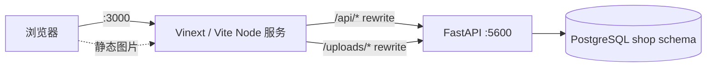

# 前端认知：架构、环境、界面与设计理念

记录人：opencode。日期：2026-10-30（Asia/Shanghai）。任务：TTXL-3，父任务 TTXL-1。
基线：本地 `dev`，提交 `e1259eaf729f26eb51b81144d7d3f096c0789821`。

本报告只读检查 `frontend/` 源码、配置、锁文件、静态素材及相关设计文档。没有安装依赖、构建、启动/停止服务、运行检查、修改源码、提交或部署；没有读取真实环境文件或业务上传内容。除本文件外没有写入任何位置。设计结论来自源码与样式表，未做浏览器视觉验证。

## 1. 结论摘要

- 实际运行栈是 **React 19.2.6 + Vinext 1.0.0-beta.2 + Vite 8.0.13**，不是 Next.js。`app/`、`next/link`、`next/navigation`、`next/image`、`next.config.ts` 是 Next 风格接口，由 Vinext 的 shim 在 Vite 构建时接管；仓库没有安装 `next` 包。
- 前端是纯客户端数据应用：10 个路由页面全部标记 `"use client"`，数据通过 Axios 调 FastAPI；没有 Server Actions、Route Handlers 或服务端数据获取。
- 同源 `/api` 与 `/uploads` 由 `next.config.ts` 重写到 Docker 服务名 `http://api:5600`；默认只在 Compose 网络内成立，宿主机直接 `pnpm dev` 需要额外处理。
- 会话用 JWT + `localStorage`，按 `/admin` 路径分成管理员与顾客两套独立会话；Axios 拦截器统一加 Bearer、处理 401 过期和停用账号。
- 视觉是米白纸面、苔绿、金色点缀的手作档案风：Georgia/Songti 衬线大标题、四列商品网格、首页 GSAP 渐入；Ant Design 未做主题定制，默认蓝色主按钮与品牌苔绿并存。
- 商品图是 17 张 1122×1402 的本地 PNG，单张约 1.2–1.8 MB（平均约 1.6 MB），`public/images` 合计约 29 MB；首页用原生 `` 全部立即加载，没有响应式图或懒加载。
- 分子资料来自 2026-10-26 的 PubChem 快照，共 13 个分子；海洛因 I/II 型、THC、迷幻剂明确显示“结构待确认”。
- Cloudflare D1/R2 只是 Vinext starter 的残留示例：`hosting.json` 绑定为空、`db/schema.ts` 为空、没有页面引用，当前商城不参与 D1。
- 主要风险：首页 SSR 为空壳、宿主机代理前提、29 MB 图片、移动端隐藏登录入口、首页硬编码 17 件与接口 18 件不一致、静态商品图按名称覆盖后台新图。

## 2. 实际架构与 Next 风格目录的关系

### 2.1 请求路径



`frontend/next.config.ts` 定义两条 rewrite：

- `/api/:path*` → `http://api:5600/api/:path*`
- `/uploads/:path*` → `http://api:5600/uploads/:path*`

`api` 是 Compose 服务名；根 `docker-compose.yml` 与 `deploy/compose.yml` 都把后端服务命名为 `api`，因此容器内代理成立。宿主机直接运行前端时 `api` 通常无法解析，见第 3.3 节。

### 2.2 Next 风格接口由 Vinext 提供

| 证据 | 说明 |
| --- | --- |
| `frontend/package.json` | 依赖中没有 `next`；`vinext` 1.0.0-beta.2、`vite` 8.0.13、`@vitejs/plugin-rsc`、`react-server-dom-webpack` 在 devDependencies。 |
| `frontend/vite.config.ts` | 只有 `plugins: [vinext()]`，没有手写 React 插件或路由插件。 |
| `frontend/next-env.d.ts` | `import "vinext/types"; import "./.next/types/routes.d.ts";`，类型入口指向 Vinext，不是 Next。 |
| `node_modules/vinext/package.json` | 包描述为 “Run Next.js apps on Vite. Drop-in replacement for the next CLI.” |
| `node_modules/vinext/dist/shims/public-shim-map.json.js` | `next/link`、`next/image`、`next/navigation`、`next/server` 等映射到 `dist/shims/*`。 |
| `node_modules/vinext/dist/config/next-config.js`、`dist/entries/app-rsc-entry.js` | Vinext 读取 `next.config` 的 `rewrites` 等字段并注入请求管线（源码证据，未运行时验证）。 |

因此 `app/layout.tsx`、`app/**/page.tsx`、`export const metadata`、`"use client"`、`next/link`、`next/navigation`、`next/image` 都能按 Next 习惯书写，但编译与运行由 Vinext/Vite 完成。`app/layout.tsx` 没有 `"use client"`，是路由树中唯一的服务端入口；所有 `page.tsx` 都是客户端组件。

### 2.3 RSC 与客户端渲染

- `@vitejs/plugin-rsc` 与 `react-server-dom-webpack` 表明构建链启用了 React Server Components 能力。
- 页面本身全部 `"use client"`，实际数据获取都在 `useEffect` 中完成；`layout.tsx` 只输出 `<html lang="zh-CN"><body>{children}</body></html>` 和全站 metadata。
- 没有 `loading.tsx`、`error.tsx`、`not-found.tsx`、`template.tsx`、`middleware.ts`；加载、错误、空状态由 Ant Design 的 `Spin`、`Empty`、`Result` 和页面内联文案处理。

### 2.4 已知的 Vinext Link 运行时限制

`app/products/[id]/page.tsx`、`app/cart/page.tsx`、`app/login/page.tsx`、`app/tracking/page.tsx` 都在文件头写了同一段 eslint 禁用注释：

> Native navigation avoids the current Vinext Link RSC runtime error.

因此这些页面内部导航主要用原生 `<a>` 或 `window.location`，只有首页品牌位使用 `next/link`。这意味着多数站内跳转是整页刷新，不是客户端路由切换。该问题只在源码注释中声明，本次没有启动服务复现。

### 2.5 模板残留

- `app/_sites-preview/SkeletonPreview.tsx` 与 `preview.css` 是站点生成器的加载骨架，下划线前缀目录不参与路由，也没有任何页面引用。
- `public/file.svg`、`public/window.svg`、`public/favicon.svg` 没有被 `app/` 引用；`layout.tsx` 也没有设置 `icons`。
- `react-router-dom`、`ipaddr.js` 在 `app/` 中没有 import；`react-loading-skeleton` 只被上述预览骨架使用；`drizzle-orm`/`drizzle-kit` 只在 D1 示例和 `db/` 中使用。依赖清单保留了 starter 的痕迹。

## 3. 本地环境与构建前提

### 3.1 Node / pnpm

| 项目 | 要求 / 实测 |
| --- | --- |
| Node | `package.json` `engines.node >=22.13.0`；本机实测 `v24.13.0`。 |
| pnpm | `packageManager: pnpm@11.21.0`；本机实测 `11.21.0`。 |
| Corepack | 本机 `0.34.5`；Dockerfile 用 `corepack enable` 启用。 |
| 工作区 | `pnpm-workspace.yaml` 只配置 `allowBuilds: esbuild/sharp/workerd`，没有多包 workspace。 |
| 锁文件 | `pnpm-lock.yaml` 已提交；Docker 构建使用 `pnpm install --frozen-lockfile`。 |
| 本地依赖 | `node_modules/` 存在；抽查 antd 6.6.0、react 19.2.6、vinext 1.0.0-beta.2、vite 8.0.13 与声明一致。未重新安装。 |

### 3.2 脚本与构建产物

| 脚本 | 实际行为 |
| --- | --- |
| `pnpm dev` | `WRANGLER_LOG_PATH=.wrangler/wrangler.log vinext dev` |
| `pnpm build` | 同上环境变量后 `vinext build` |
| `pnpm start` | 同上环境变量后 `vinext start` |
| `pnpm lint` | `eslint . --ignore-pattern dist --ignore-pattern .next` |
| `pnpm check` | `tsc --noEmit && eslint ...` |
| `pnpm test` | `npm run check`，即类型检查 + ESLint；`frontend/tests/` 为空，没有单元/端到端测试。 |

`frontend/Dockerfile` 用 `node:22-bookworm-slim` 构建：复制 `package.json`/锁文件/workspace → `corepack enable && pnpm install --frozen-lockfile` → 复制源码 → `pnpm build` → 删除 `.env.local` → 最终镜像复制整个 `/app`，用 `node node_modules/vinext/dist/cli.js start --host 0.0.0.0 --port 3000` 启动。`deploy/Dockerfile.frontend` 复用 bootstrap 镜像的 `node_modules`，并在构建时清除 bootstrap 遗留的 `NEXT_PUBLIC_*`，让 `frontend/.env.local` 生效。

`frontend/dist/`、`frontend/.next/`、`frontend/.vinext/`、`frontend/.wrangler/` 都是本地生成物且被 gitignore；它们只能证明过去构建/运行过，不能证明与当前源码一致。`next-env.d.ts` 显式引用 `.next/types/routes.d.ts`，该文件由 Vinext 生成且不在版本控制中；新克隆在首次 `vinext dev/build` 前直接跑 `tsc` 可能报缺失模块（本次未运行验证）。

### 3.3 环境变量与代理前提

`frontend/.env.example` 只有三项，均为公开变量：

```dotenv
NEXT_PUBLIC_API_URL=/api
NEXT_PUBLIC_AMAP_KEY=
NEXT_PUBLIC_AMAP_SECURITY_JS_CODE=
```

- `NEXT_PUBLIC_*` 在构建时写入客户端 bundle，修改后必须重新构建；README 明确说明不能只重启容器。
- 本机存在 `frontend/.env.local`（未读取内容）；它被 `.gitignore` 忽略，但 `.dockerignore` 用 `!.env.local` 让它进入构建上下文，构建后再从最终镜像删除。
- 默认 `NEXT_PUBLIC_API_URL=/api` 时，Axios 走同源 `/api`，依赖 `next.config.ts` 的 `api:5600` 代理。宿主机直接 `pnpm dev` 时，`api` 不是可解析主机名，除非：
  1. 前端也在 Compose 网络内运行；
  2. 给宿主机增加 `api` 主机映射；
  3. 把 `NEXT_PUBLIC_API_URL` 改成绝对地址，例如 `http://127.0.0.1:5600/api`。后端 `CORS_ORIGINS` 默认包含 `http://localhost:3000`/`http://127.0.0.1:3000`，因此绝对地址方案在源码配置上可行（未实测）。
- `NEXT_PUBLIC_AMAP_KEY` 与安全密钥都为空时，`PickupMap` 不加载高德 SDK，只显示搜索/复制地址按钮；配置后才注入 `webapi.amap.com/loader.js`。

本次没有运行 `pnpm dev/build/start/check/test`，也没有读取 `.env.local` 的真实值。

## 4. 接口代理、认证与会话

### 4.1 Axios 实例

`app/shop.tsx` 是全局客户端基础设施：

- `api = axios.create({ baseURL: process.env.NEXT_PUBLIC_API_URL || "/api" })`。
- 请求拦截器按当前路径决定会话 scope：`window.location.pathname.startsWith("/admin") ? "admin" : "customer"`；读取对应 `localStorage` token，写入 `Authorization: Bearer <token>`，并把 `{scope, token}` 记录在 `WeakMap` 中供响应拦截器判断。
- 响应拦截器只对 401（排除登录请求本身）和 403 且 `message === "该用户已停用"` 做失效处理；只有“请求发出时的 token 仍等于当前存储 token”才清除，避免旧响应清掉新会话；只有 scope 仍是当前页面 scope 才更新 Zustand 和跳转；模块级 `loginRedirectPending` 防止并发 401 重复跳转。
- 失效后跳 `/login?reason=expired` 或 `?reason=disabled`，登录页据此显示提示。

### 4.2 会话存储

| 键 | 内容 |
| --- | --- |
| `mystery_customer_token` / `_username` / `_role` | 顾客会话 |
| `mystery_admin_token` / `_username` / `_role` | 管理员会话 |

- 登录成功时 `setSession` 按返回的 `user.role` 选择 scope：`admin` 存管理员键，其他存顾客键；随后 `window.location.assign(role === "admin" ? "/admin" : "/")`。
- 由于 scope 由当前路径决定，管理员在 `/admin` 之外浏览商城时不会携带管理员 token；顾客与管理员会话互不覆盖。这是有意设计，也意味着管理员不能以登录态在店面加购物车。
- `hydrate()` 在组件挂载后恢复 localStorage 会话，并调用 `GET /auth/me` 校验；网络错误不会清除本地登录；若校验期间 token 已被替换，则忽略旧响应。JWT 有效期按 README 为 12 小时，实际签发在后端。
- 首页用 `useSyncExternalStore` 保证服务端与浏览器首次渲染一致：服务端快照返回 `false`，hydration 后才渲染真实页面。因此首页服务端 HTML 只有一个 `aria-busy` 空壳，商品与文案依赖 JS 渲染；这是源码逻辑结论，未用浏览器验证首屏表现。

### 4.3 安全边界

- Token 存 `localStorage`，任何 XSS 都可读取；前端没有 HttpOnly Cookie 方案。
- 评论内容用 `dangerouslySetInnerHTML` 渲染，富文本编辑器使用 `document.execCommand`；XSS 防护依赖后端清洗（总览记录后端有富文本清洗），前端不做二次净化。
- 权限展示只是 UI 层：`/admin` 在 hydration 后检查 `role === "admin"`，否则 `router.replace("/login")`；真正的接口权限由 FastAPI 的 `current_admin` 依赖执行。
- 请求用 Bearer 而非 Cookie，因此没有传统 CSRF 面；后端 CORS 默认只允许本地开发源。

### 4.4 前端实际调用的接口

前端 baseURL 已带 `/api`，下表省略该前缀。

| 领域 | 方法与路径 | 调用位置 |
| --- | --- | --- |
| 商品 | `GET /products`、`GET /products/{id}` | 首页、商品详情 |
| 评论 | `GET /products/{id}/comments`、`POST /products/{id}/comments`、`POST /comment-images` | `ProductComments` |
| 认证 | `POST /auth/register`、`POST /auth/login`、`POST /auth/forgot-password`、`POST /auth/reset-password`、`GET /auth/me` | 登录/注册/找回/重置、`hydrate` |
| 地址 | `GET /account/address`、`PUT /account/address` | 购物车 |
| 支付方式 | `GET /payment-methods`、`POST /payment-methods` | 购物车 |
| 购物车 | `GET /cart`、`POST /cart`、`PATCH /cart/{itemId}`、`DELETE /cart/{itemId}` | 首页、详情、购物车 |
| 订单 | `POST /orders`、`GET /orders/{id}` | 购物车、订单详情 |
| 物流 | `GET /tracking/options`、`GET /tracking/subscription-options`、`POST /tracking/query` | 物流页 |
| 管理 | `GET /admin/dashboard` | `DashboardPanel` |
| 管理 | `GET /admin/users`、`POST /admin/users/{id}/disable`、`POST /admin/users/{id}/restore` | 用户管理 |
| 管理 | `GET /admin/products`、`POST /admin/products`、`POST /admin/products/images`、`POST /admin/products/{id}/restock`、`POST /admin/products/{id}/unlist`、`POST /admin/products/{id}/relist`、`POST /admin/products/{id}/price` | 商品管理 |

后端还有 `GET /api/admin/audit-logs`，前端没有入口或调用。以上路径均能在 `backend/shop_api/routers.py`、`admin_router.py`、`tracking.py` 中找到对应路由；前端没有调用不存在的接口（以静态比对为准，未发请求验证）。

## 5. 页面与业务路径

| 路由 | 文件 | 访问前提 | 主要行为 |
| --- | --- | --- | --- |
| `/` | `app/page.tsx` | 公开 | 取商品列表；名称/简介关键词过滤；登录后可加购物车；低库存提示；英雄区、故事区、声明区；GSAP 入场。 |
| `/products/[id]` | `app/products/[id]/page.tsx` | 公开 | 取详情；数量选择；加购物车；评论；分子资料卡；图片占位；错误重试。 |
| `/cart` | `app/cart/page.tsx` | 顾客登录 | 购物车、默认地址、银行卡并行加载；勾选/改数量/删除；地址、配送、支付、银行卡；提交订单后跳订单页。 |
| `/orders/[id]` | `app/orders/[id]/page.tsx` | 后端鉴权 | 显示订单结果、商品、账号、电话、配送/自提地址、飞书通知状态；非自提订单给出物流入口。 |
| `/login` | `app/login/page.tsx` | 公开 | 用户名或邮箱登录；按角色跳 `/admin` 或 `/`；显示过期/停用原因。 |
| `/register` | `app/register/page.tsx` | 公开 | 账号、邮箱、密码、确认密码；前端只校验必填/长度/邮箱格式/两次一致，强度由后端最终校验。 |
| `/forgot-password` | `app/forgot-password/page.tsx` | 公开 | 输入注册邮箱，调用后端发送 30 分钟重置链接。 |
| `/reset-password` | `app/reset-password/page.tsx` | 公开（带 token） | 从 query 取 token，设置新密码并跳登录。 |
| `/tracking` | `app/tracking/page.tsx` | 查询需登录 | 取快递商与推送开关；选择快递、输入运单号；查询/登记；时间线结果。 |
| `/admin` | `app/admin/page.tsx` | 管理员会话 | 用户管理、商品管理、管理看板三个面板。 |

没有独立的管理员登录页、404 页、错误边界或移动端菜单页。

### 5.1 首页

- `useEffect` 调 `GET /products`，失败时 Ant Design message 提示“暂时无法取得商品资料”。
- 搜索只对 `name + tagline` 做大小写敏感的 `includes`；`lsd` 不会匹配 `LSD`。
- 加购物车需要 `token`；未登录只提示“登录后即可将作品加入购物车”，不自动跳登录。
- 商品卡显示名称、简介、价格、库存；`lowStock` 时显示“仅剩 N 件”；售罄按钮禁用。
- 文案硬编码 `THE COLLECTION / 17 PIECES`。总览记录本地接口返回 18 件商品，首页未从数据计算数量；若新增第 18 件，标题会与列表不一致。
- GSAP 时间线：顶栏下移渐入、英雄文案逐项上移、英雄图缩放渐入、故事区上移；商品卡在数据到达后错峰渐入；全部受 `prefers-reduced-motion` 保护。CSS 的 `html { scroll-behavior: smooth }` 没有单独的减少动效分支。

### 5.2 商品详情

- 用 `useParams` 取 `id`，`GET /products/{id}`；失败显示错误文案和“重新加载”，通过 `attempt` 计数重试。
- 主图用 `productImage(product)`；除血清素外，第二张“产品实拍图”和第三张“模特佩戴图”都是虚线占位。血清素的第二张是 `serotonin-reference.jpg`，第三张仍是占位。
- 数量 `InputNumber` 上限为库存；加购调 `POST /cart` 后刷新全局购物车数量。
- `MoleculeCard` 按商品名查本地快照；无资料时显示“结构待确认”，并针对海洛因 I/II、THC、迷幻剂给出具体原因。
- `ProductComments` 独立加载评论；登录后才能上传图片或发布；编辑器支持加粗、斜体、下划线、文字颜色和图片；提交 `{content, imageIds}`。

### 5.3 购物车与下单

- 未登录直接显示“登录后管理购物车”和去登录按钮；登录后并行请求 `/cart`、`/account/address`、`/payment-methods`。
- 加载后默认勾选全部购物车项；改数量走 `PATCH /cart/{id}`，删除走 `DELETE /cart/{id}`，每次操作后重新加载并重置勾选。
- 地址表单使用 `@vant/area-data` 的省/市/区数据构建 Cascader；默认地址是江苏省/常州市/天宁区。`types/area-data.d.ts` 手写声明补足该包未导出的类型。
- 配送选项 6 个：线下自提、顺丰次日达（¥5）、圆通、国通、申通、韵达（后四者包邮）。后端 `routers.py` 的 `options` 还接受 `standard` 别名，前端不展示。
- 选“线下自提”时显示 `PickupMap`：固定门店“小行星桌游社”、地址、GCJ-02 坐标；配置高德 Key 后加载 JS API 2.0 地图、红点标记、比例尺和工具栏；未配置或加载失败仍可打开高德搜索或复制地址。
- 支付方式：微信、支付宝、银行卡。银行卡前端做 Luhn 校验（12–19 位），保存后只显示末四位；后端负责加密保存。页面明确“目前不提供线上支付跳转”。
- 提交前校验：至少选一件、收件人姓名、`1[3-9]` 开头的 11 位大陆手机号、非自提时省市区和详细地址、银行卡支付时必须有卡。通过后 `POST /orders`，带 `itemIds`、`deliveryService`、`paymentType`、`paymentMethodId`、`address`，成功跳 `/orders/{id}`。
- 金额只在前端汇总展示；最终价格、库存扣减、配送费由后端订单接口决定。

### 5.4 订单详情

- `GET /orders/{id}`；未加载时只显示 `Spin`，没有专门的错误态或 404 处理。
- 展示订单号、商品明细、下单账号、手机号、配送服务、配送地址或自提点；`notificationStatus === "notified"` 显示“飞书已通知”，否则显示“飞书通知待重试”。
- 非自提订单显示“快递查询”卡片，跳 `/tracking`；自提订单不显示。
- 页面本身不检查登录，依赖后端对订单归属的校验；接口失败时没有错误态，403/404/网络错误会停留在加载态，401 则由 Axios 拦截器跳登录（源码逻辑）。

### 5.5 认证页面

- 登录页读取 `reason` query，显示“登录已过期”或“该用户已停用”；登录成功后管理员跳 `/admin`，顾客刷新购物车后回首页。
- 注册页前端校验账号至少 3 位、邮箱格式、两次密码一致；密码强度提示“至少 9 位，含大小写字母、数字和特殊字符”，但前端没有对应正则，最终由后端拒绝弱密码。
- 找回密码页只提交邮箱；成功文案来自后端，避免前端泄露账号是否存在。
- 重置密码页从 URL 取 token；无 token 时提示链接无效；成功后跳登录。页面说明重置会使旧登录状态失效。

### 5.6 物流查询

- 并行取 `/tracking/options` 与 `/tracking/subscription-options`；前者给快递商列表与总开关，后者决定是“主动查询”还是“登记后读推送”。
- 未登录时提交按钮变成“登录后查询物流”链接；未开通时显示管理员配置提示。
- 运单号去空格转大写；主动查询模式要求 6–40 位字母数字，推送模式要求 6–30 位；商城订单号不能当运单号。
- 结果展示快递公司、运单号、状态、来源（主动查询/5 分钟缓存/自动推送）、订阅状态、快递更新时间、本站同步时间、最近推送时间、轨迹时间线和本次查看时间。
- 支持快递商与后端一致：圆通、申通、极兔、百世；顺丰、韵达、中通、EMS 显示“暂未接入”。

### 5.7 管理后台

- `/admin` 先 `hydrate()`，`ready` 后若没有 token 或角色不是 admin，`router.replace("/login")`；在 ready 前返回 `null`，所以服务端 HTML 为空。
- 左侧菜单三项：用户管理、商品管理、管理看板；没有审计日志入口。
- 用户管理：启用/停用 Tab、用户名筛选、创建日期范围、分页表格、默认地址、角色/状态标签、停用/恢复确认。
- 商品管理：上架/下架 Tab、关键词筛选、分页；补货、价格调整（手动价或按 10/20/30% 升降）、下架理由、重新上架（价格+数量）、上新（名称、价格、数量、简介、故事、图片上传）。
- 管理看板：周期 7/30/90 天或自定义、当日下单量/销售额、累计销售额、启用用户、上架/缺货/低库存商品、每日订单 SVG 柱状图、商品售出排行、用户下单统计、库存提醒、订单销售明细筛选与分页。
- 看板“销售额”来自模拟订单记录，不代表真实收款；库存是当前库存，不是历史快照。

## 6. 组件与状态

### 6.1 全局状态

`app/shop.tsx` 的 Zustand store `useShop` 只保存：

- `token`、`username`、`role`、`cartCount`
- `hydrate()`、`setSession()`、`clearSession()`、`refreshCart()`

没有使用 `persist` 中间件，localStorage 读写全部手写；没有 React Query/SWR，页面各自用 `useState` + `useEffect` 拉数据，因此没有跨页缓存、请求去重或自动重试。`refreshCart()` 通过 `GET /cart` 求和数量；管理员 scope 直接置 0。

### 6.2 组件清单

| 组件 | 职责 |
| --- | --- |
| `app/page.tsx` 内 `Topbar` | 首页专用顶栏：品牌、锚点导航、登录/注册/账号、管理后台入口、购物车数量。不是全局布局组件。 |
| `app/components/MoleculeCard.tsx` | 按商品名读取 `molecules.json`，展示 PubChem 结构图、分子式、分子量、CID、IUPAC 名和来源；无资料时显示待确认说明。 |
| `app/components/ProductComments.tsx` | 评论列表、富文本编辑器、图片上传、发布。 |
| `app/components/PickupMap.tsx` | 自提点地址、复制、高德搜索、可选内嵌地图；SDK 懒加载并带超时/重试。 |
| `app/admin/DashboardPanel.tsx` | 经营看板指标、SVG 趋势图、排行、明细表。 |
| `app/_sites-preview/SkeletonPreview.tsx` | 未引用的模板骨架屏。 |

`MoleculeCard` 没有 `"use client"`，但被客户端商品页导入，实际会进入客户端 bundle；它导入的 JSON 快照也随包加载。

### 6.3 页面导航结构

- 只有首页有完整顶栏；商品详情、购物车、物流、认证页、订单页各自提供“返回”链接。
- 首页品牌用 `next/link`，其余站内跳转大量使用原生 `<a>`/`window.location`，原因是第 2.4 节的 Vinext Link 限制。
- 没有全局布局中的导航、页脚或登录状态条；每个页面自行处理。

## 7. 设计系统

以下结论来自 `app/globals.css`、页面内联样式与 Ant Design 默认值，未做浏览器视觉验证。

### 7.1 配色

| 变量 / 值 | 色值 | 用途 |
| --- | --- | --- |
| `--ink` | `#17201c` | 主文字、深色标题 |
| `--cream` | `#f6f2ea` | 页面底色、顶栏半透明底 |
| `--paper` | `#fffdf9` | 卡片、评论、商品卡底色 |
| `--moss` | `#265842` | 品牌主色、按钮/链接、价格、深色声明区 |
| `--gold` | `#c49751` | 购物车角标、评论左边框、金色标签 |
| `--muted` | `#68736d` | 次要文字 |
| 辅助绿 | `#e6ece5` / `#eaf0e7` / `#edf3e9` | 故事区、占位图、分子标签、选中态 |
| 辅助红 | `#ae3d32` / `#cf1322` / `#a61d24` | 售罄、低库存、错误 |
| AntD 蓝 | `#1677ff` | 结账区选中边框、图标、部分按钮默认色 |

Ant Design 没有 `ConfigProvider` 或主题 token 定制；`type="primary"` 的按钮使用 AntD 默认蓝色。结账区又显式写了 `#1677ff` 的边框、图标和阴影，因此品牌苔绿/金色与 AntD 蓝在同一页面并存。是否为有意混搭无法从源码判断。

### 7.2 字体

- 正文：`Arial, "PingFang SC", "Microsoft YaHei", sans-serif`。
- 展示标题：`Georgia, "Songti SC", serif`；部分位置只写 `Georgia` 或 `Georgia, serif`。
- 没有 `next/font`、没有本地字体文件、没有网络字体请求；依赖系统字体。Android 上 Georgia/Songti 可能缺失，中文标题会回退到默认衬线/黑体。

### 7.3 布局

- 顶栏高 72 px，`position: sticky`，左右 `5vw`，底部 1 px 暖灰分隔线。
- 首页英雄区最大宽 1280 px，双列 `1fr / 1.05fr`，间距 72 px；故事区全宽双列 `0.85fr / 1fr`；商品区最大宽 1280 px，四列网格。
- 商品详情/购物车最大宽 1180 px；详情双列 `1.15fr / 0.85fr`，间距 65 px；主图高 420 px，第二/三图各 170 px。
- 物流页最大宽 1000 px；管理后台内容最大宽 1500 px，侧栏 218 px。
- 卡片多为无圆角或 8–14 px 圆角，细边框 + 很浅阴影；整体是“纸张/档案”而非玻璃拟态。

### 7.4 动效

- 首页 GSAP：顶栏 `y:-20` 渐入、英雄文案 `y:24` 逐项 stagger 0.08、英雄图 `scale:0.96`、故事区 `y:26`、商品卡 `y:24` stagger 0.06；`ease: power2.out`。
- 所有 GSAP 初始化都检查 `window.matchMedia("(prefers-reduced-motion: reduce)").matches`，命中则完全跳过。
- CSS 动效只有商品图 hover `transform: scale(1.05)`（0.35 s）和 `scroll-behavior: smooth`；没有骨架屏、页面过渡或复杂 keyframes。
- 加载态主要用 AntD `Spin`，没有为商品卡做 skeleton。

### 7.5 响应式

| 断点 | 主要变化 |
| --- | --- |
| `max-width: 820px` | 顶栏导航隐藏；非购物车的头部链接隐藏；英雄/故事/详情改单列；商品网格 2 列；搜索框下移；详情标题 45 px；地址表单 4 列改 2 列；配送 6 列改 3 列。 |
| `max-width: 500px` | 顶栏左右 18 px；购物车文字隐藏；首页/详情/购物车左右 20 px；商品网格 1 列；故事标题 38 px；商品图高 310 px；地址表单改 1 列；配送改 2 列；结账区压缩。 |
| `max-width: 900px` | 只作用于旧类 `.checkout-details`（当前购物车未引用），不应视为当前结账布局。 |
| `max-width: 1100px` | 看板四列指标改 3 列；看板双列改单列。 |
| `max-width: 760px` | 分子卡双列改单列。 |
| `max-width: 720px` | 管理后台侧栏改顶部横向菜单。 |
| `max-width: 650px` | 物流快递商 4 列改 2 列。 |
| `max-width: 620px` | 看板指标 2 列。 |
| `max-width: 420px` | 分子事实 3 列改 2 列。 |

移动端 `<=820px` 隐藏了顶部导航和登录/注册链接（已登录时账号名与退出按钮仍在），未登录用户头部只剩购物车；没有汉堡菜单或替代入口。用户仍可通过加购提示、购物车页或直接 URL 进入登录，但首页头部没有可见的登录/注册入口。这是源码层面的可用性缺口。

### 7.6 可访问性与 CSS 组织

- `html lang="zh-CN"`；图片有 alt；物流页有 `aria-label`、`role="status"`、`aria-live`、`aria-invalid`、`focus-visible`；评论工具栏按钮有 `aria-label`；自提地图有 `role="region"`。
- 没有 skip link、没有全局 focus 样式、没有暗色模式；`contentEditable` 编辑器依赖浏览器默认行为。
- 所有样式集中在 `app/globals.css`（49 个物理行，大量超长单行规则）和 `_sites-preview/preview.css`；没有 CSS Modules，也未发现 Tailwind 工具类。`@import "tailwindcss"` 实际主要提供 preflight/基础层，页面类名都是自定义类。
- 同一批 `.delivery-option` 规则在文件中重复出现三次，并用大量 `!important` 覆盖 AntD 结构；后续改结账样式时容易互相覆盖。

## 8. 商品素材与分子数据

### 8.1 商品图片

- `public/images/` 共约 29 MB；17 张商品 PNG 都是 `1122 × 1402`，单张约 1.2–1.8 MB（平均约 1.6 MB）。
- 文件与商品名的对应写在 `app/shop.tsx` 的 `productImages`：血清素、可卡因、尼古丁、肾上腺素、咖啡因、LSD、苯、吗啡、地巴唑、戊巴比妥、薄荷醇、乙醇、THC、迷幻剂、海洛因 I/II 型、裸盖菇素。
- `productImage(product)` 先按中文名查静态表，命中就用本地图；未命中才用后端返回的 `product.image`。后端上传图以 `/uploads/` 开头时，`productAssetUrl` 会拼上 API 源站（`NEXT_PUBLIC_API_URL` 去掉末尾 `/api`）。
- 这意味着：**已有 17 个名称的商品即使在后台上传了新图，前台仍显示静态图**；只有新名称商品才会走上传图。若新品重名，也会被静态图覆盖。
- 首页商品卡和详情主图用原生 ``，没有 `loading="lazy"`、`srcset` 或 `next/image`；17 张图会在首页一次性请求。只有 `MoleculeCard` 用 `next/image` 且 `unoptimized`。
- `design.jpg`（1440×994）用于首页英雄区，`draft.jpg`（1279×1706）用于故事区；`product.jpg`（1206×1588）没有被页面引用，只在图片生成文档中作为形状参考。`serotonin-reference.jpg` 只用于血清素详情第二图。
- 图片风格文档：`docs/molecular-necklace-image-prompts.md`、`docs/molecular-necklace-image-prompts-batch-2.md`、`docs/heroin-i-image-prompt.md`。共同设定是抛光黄金轮廓、球形节点、午夜蓝珐琅、海蓝宝石心形主石、浅蓝/浅粉小 cabochon、金色链、浅蓝或白色背景的珠宝微距摄影。它们描述商品素材，不是 UI 配色规范。

### 8.2 分子资料

- `app/data/molecules.json` 是 2026-10-26 的 PubChem/NIH 快照，含 13 个分子：苯、尼古丁、血清素、肾上腺素、咖啡因、可卡因、LSD、吗啡、地巴唑、戊巴比妥、薄荷醇、乙醇、裸盖菇素。
- 每个条目含 CID、英文参考名、类别、中文描述、分子式、分子量、IUPAC 名、本地结构图路径和 PubChem 来源 URL；结构图在 `public/images/molecules/{cid}.png`（300×300）。
- `frontend/scripts/sync-molecules.mjs` 手动运行：按英文名查 PubChem PUG REST，校验唯一命中、字段完整、PNG 魔数后写入快照；脚本只在手动刷新时访问 PubChem，访客打开页面不请求外部。
- 未收录的 4 个商品名正好是 `MoleculeCard` 的 `ambiguousNames`：海洛因 I 型、海洛因 II 型、THC、迷幻剂。前两者是系列名，THC 有异构体，迷幻剂是类别名，因此显示“结构待确认”，不猜测数据。
- 其他未收录的新商品也走同一个待确认卡片；不会自动生成分子资料。

### 8.3 17 与 18 的差异

首页文案固定写 `17 PIECES`，静态商品图也是 17 个名称；总览记录本地 `GET /api/products` 返回 18 件。差异可能来自后台新增的第 18 件商品。本次没有调用接口或查库复核，因此只记录为待核实项：如果第 18 件是新品，它会出现在网格中，但标题仍写 17，且没有对应的静态商品图和分子资料。

## 9. Cloudflare D1 示例是否参与当前商城

结论：**不参与**。证据链如下：

| 证据 | 说明 |
| --- | --- |
| `frontend/.openai/hosting.json` | `{"d1": null, "r2": null}`，没有绑定。 |
| `frontend/db/index.ts` | 从 `cloudflare:workers` 取 `env.DB`，用 `drizzle-orm/d1`；没有绑定就抛错。 |
| `frontend/db/schema.ts` | 只有注释和 `export {}`，没有表。 |
| `frontend/drizzle/meta/_journal.json` | `entries: []`，没有迁移。 |
| `frontend/examples/d1/app/api/notes/route.ts`、`examples/d1/db/schema.ts` | 一个 notes 示例 API 和 sqlite 表，不在 `app/` 路由树内。 |
| `frontend/tsconfig.json` | `exclude: ["node_modules", "db", "examples"]`，示例不参与类型检查。 |
| `frontend/app/**` | 没有任何文件 import `db/`、`drizzle` 或 D1。 |

当前商城的业务数据全部经 Axios 到 FastAPI，再由 SQLAlchemy 访问 PostgreSQL 的 `shop` schema；分子资料是前端本地 JSON 快照。Vinext 本身是 Cloudflare 的 Next-on-Vite 工具链，仓库也保留了 `wrangler`、`@cloudflare/vite-plugin` 和 `.wrangler/` 日志目录；但生产 Dockerfile 用 Node 启动 `vinext start`，没有 D1/R2 绑定，也没有 `wrangler.toml`。因此这些是 starter/开发工具残留，不是商城运行时依赖。

## 10. 重要文件证据

| 文件 | 能证明什么 |
| --- | --- |
| `frontend/package.json` | 实际依赖、脚本、Node/pnpm 版本要求；没有 `next`。 |
| `frontend/pnpm-lock.yaml` | 依赖锁定；Docker 用 frozen lockfile。 |
| `frontend/pnpm-workspace.yaml` | 只允许 esbuild/sharp/workerd 构建脚本。 |
| `frontend/vite.config.ts` | 构建入口只有 `vinext()`。 |
| `frontend/next.config.ts` | `/api`、`/uploads` 到 `api:5600` 的 rewrite。 |
| `frontend/next-env.d.ts` | 类型来自 `vinext/types` 和生成的 `.next/types/routes.d.ts`。 |
| `frontend/tsconfig.json` | `@/*` 路径别名；排除 `db`/`examples`。 |
| `frontend/Dockerfile` | Node 22 构建、corepack/pnpm、构建后删除 `.env.local`、Node 启动。 |
| `deploy/Dockerfile.frontend` | 复用 bootstrap 依赖缓存、清除遗留 `NEXT_PUBLIC_*`、构建时读取 `.env.local`。 |
| `frontend/.env.example` | 三个公开变量及默认 `/api`。 |
| `frontend/app/layout.tsx` | 全站 metadata、`lang="zh-CN"`、唯一服务端布局。 |
| `frontend/app/globals.css` | 配色变量、字体、布局、断点、动效、AntD 覆盖。 |
| `frontend/app/page.tsx` | 首页数据、搜索、加购、GSAP、hydration 空壳、17 件文案。 |
| `frontend/app/shop.tsx` | Axios 实例、会话 scope、JWT 拦截器、Zustand、商品图映射。 |
| `frontend/app/products/[id]/page.tsx` | 详情、数量、加购、评论/分子卡组合、原生导航注释。 |
| `frontend/app/cart/page.tsx` | 购物车、地址、配送、支付、银行卡、下单。 |
| `frontend/app/orders/[id]/page.tsx` | 订单展示与飞书通知状态。 |
| `frontend/app/{login,register,forgot-password,reset-password}/page.tsx` | 认证流程与前端校验。 |
| `frontend/app/tracking/page.tsx` | 物流查询/订阅 UI 与状态文案。 |
| `frontend/app/admin/page.tsx`、`DashboardPanel.tsx` | 管理后台三个面板与客户端权限门。 |
| `frontend/app/components/*` | 分子卡、评论、自提地图。 |
| `frontend/app/data/molecules.json`、`scripts/sync-molecules.mjs` | 13 个 PubChem 分子快照与刷新方式。 |
| `frontend/db/*`、`examples/d1/*`、`drizzle.config.ts`、`.openai/hosting.json` | D1 示例未参与商城。 |
| `frontend/public/images/*` | 17 张商品图、2 张设计图、13 张分子结构图及参考图。 |
| `prompt.md` | 原始产品/功能设想：17 件商品、Ant Design、React、pnpm、Vite、状态管理、路由、Axios、测试与性能安全要求。 |
| `docs/molecular-necklace-image-prompts*.md`、`docs/heroin-i-image-prompt.md` | 商品图的珠宝视觉规范与生成记录。 |
| `docker-compose.yml`、`deploy/compose.yml` | 前端 3000、后端服务名 `api`、代理前提。 |
| `backend/shop_api/routers.py`、`admin_router.py`、`tracking.py` | 前端调用路径的后端实现与配送/快递映射。 |
| `README.md` | JWT 12 小时、AMap 配置、构建后需重启/重建、本地命令。 |

## 11. 未验证项与风险

### 11.1 未验证项

- 没有启动前端或浏览器，未验证实际视觉、hydration、GSAP 动效、AntD 主题、响应式断点和移动端交互；设计结论均来自 CSS/TSX 源码。
- 没有运行 `pnpm check`、`pnpm build`、`pnpm test` 或 ESLint；不能证明当前源码通过类型检查/构建，也不能证明 `dist/` 与当前源码一致。
- 没有调用任何 API、数据库或外部服务；18 件商品、订单/评论/支付/物流数据均未复核。
- 没有复现源码注释中的 Vinext Link RSC 运行时错误，也没有验证 `next.config.ts` rewrite 在运行时的实际行为。
- 没有验证高德地图 SDK 加载、Key 白名单、自提点坐标或地图交互。
- 没有做无障碍审计、性能测量、图片版权/授权核查；29 MB 只是文件体积，不是网络传输实测。
- 没有读取 `frontend/.env.local`、后端 `.env` 或业务上传文件；真实密钥与用户数据未检查。
- 没有验证 `next-env.d.ts` 在全新克隆、未生成 `.next/types/routes.d.ts` 时能否直接通过 `tsc`。

### 11.2 主要风险与缺口

1. **宿主机开发代理**：默认 rewrite 目标是 Docker 服务名 `api`，直接 `pnpm dev` 时 `/api` 可能无法解析；需要 Compose、hosts 映射或绝对 API URL。
2. **首页 SSR 为空壳**：`useSyncExternalStore` 的服务端快照固定为 `false`，首屏 HTML 没有商品和文案，SEO/首屏速度依赖客户端 JS。
3. **图片体积**：17 张商品图约 29 MB，首页原生 `` 全部立即加载，没有懒加载/响应式图；移动网络首屏成本高。
4. **品牌色与 AntD 默认色并存**：没有主题定制，主按钮默认蓝色，结账区又硬编码蓝色，与苔绿/金色视觉不统一。
5. **移动端入口缺失**：`<=820px` 隐藏顶部导航和登录/注册链接，未登录用户头部只剩购物车，没有汉堡菜单替代。
6. **17/18 文案漂移**：首页固定 17 件，接口当前记录为 18 件；新增商品不会自动更新标题。
7. **静态图按名称覆盖**：已有商品名永远优先本地 PNG，后台上传的新图对它们不生效；重名新品也会被覆盖。
8. **站内导航多为整页刷新**：受 Vinext Link RSC 问题影响，客户端路由体验有限；品牌位仍用 `next/link`，行为可能不一致。
9. **富文本信任边界**：`dangerouslySetInnerHTML` + `document.execCommand`，XSS 防护完全依赖后端清洗；`execCommand` 已被浏览器标记为废弃。
10. **没有前端测试**：`pnpm test` 只是类型检查 + lint；`frontend/tests/` 为空，关键下单/支付/评论/物流流程没有自动化覆盖。
11. **CSS 维护性**：单文件超长行、重复的 `.delivery-option` 规则和大量 `!important`，后续改样式容易回归。
12. **模板残留**：`_sites-preview`、`react-router-dom`、`ipaddr.js`、`react-loading-skeleton` 等增加理解成本；D1 示例容易被误认为当前数据库。

## 12. 建议的后续验证顺序

1. 在 Compose 网络内启动前端，用浏览器检查首页/详情/购物车/物流/后台的实际视觉与 hydration。
2. 先跑 `pnpm check`，再跑 `pnpm build`，确认全新克隆的 `.next/types` 生成顺序和当前源码可构建。
3. 用真实登录态走一遍加购、地址、配送、银行卡、下单、订单详情，核对前端字段与后端校验。
4. 在移动端宽度检查登录入口、顶栏、结账网格和图片加载。
5. 核对第 18 件商品的名称、图片与分子资料，决定首页数量文案和静态图映射策略。
6. 用 Lighthouse/网络面板测量首页图片传输与首屏，确认是否需要懒加载、压缩或响应式图。

以上均为后续建议，本次没有执行。
